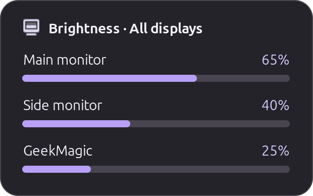

# COSMIC Display Brightness

Change an external monitor's brightness from a keyboard, a Vaydeer keypad or
a desktop shortcut. An optional popup shows the current levels.

## Features

- Control one monitor or several.
- Tap for a single change. Hold to keep adjusting.
- Keep saved monitors matched after reconnecting.
- Toggle a GeekMagic SmallTV-Ultra off and back to its remembered brightness.
- Put the popup on one screen or every connected screen.
- Keep your settings when updating.

## Screenshot



The real popup, captured with example names and brightness levels.

## Before you start

This early release was tested on Pop!_OS 24.04 with COSMIC on Wayland. You need
Python 3.11 or newer and an external monitor that supports DDC/CI, the feature
that lets your computer change the monitor's settings.

Laptop screens use a different control method. Some docks, adapters and KVM
switches block DDC/CI. A GeekMagic SmallTV-Ultra uses your local network instead.
See the [settings guide](docs/configuration.md) for its setup.

## Quick start on Pop!_OS 24.04

1. Open each monitor's own menu and turn on **DDC/CI**.

2. Open a terminal. Install the required packages:

   ```bash
   sudo apt install git python3 ddcutil python3-gi gir1.2-gtk-3.0 gir1.2-gtklayershell-0.1
   ```

3. Download and install the program:

   ```bash
   git clone https://github.com/midho/cosmic-ddc-brightness.git
   cd cosmic-ddc-brightness
   ./install.sh
   ```

   The installer finds your monitors, saves their details and starts the
   background service. It keeps any settings file you already have.

4. Check the setup and show the popup:

   ```bash
   ~/.local/bin/cosmic-ddc-brightness doctor
   ~/.local/bin/cosmic-ddc-brightness show
   ```

   `doctor` reports problems with the setup. `show` displays the current
   brightness without changing it.

5. Add your keyboard shortcuts using the commands below.

## Choose your keys

Open **Settings → Keyboard → Keyboard shortcuts → Custom** in COSMIC. Add a
custom shortcut for each action you want, paste its command and choose a key
combination that is free.

| Action | Command |
|---|---|
| Lower brightness | `cosmic-ddc-brightness down` |
| Raise brightness | `cosmic-ddc-brightness up` |
| Select the next brightness target | `cosmic-ddc-brightness cycle-monitor` |
| Show the current levels | `cosmic-ddc-brightness show` |

The service starts with all configured displays selected. The target command
then cycles through each display and returns to all displays.

For held keys, follow the [Solaar guide](docs/integrations/solaar.md) or the
[Input Remapper and Vaydeer guide](docs/integrations/input-remapper.md). The
[COSMIC guide](docs/integrations/cosmic.md) also explains what to do if a
shortcut cannot find the command.

## Commands

Run these in a terminal, or bind them to keys:

```text
cosmic-ddc-brightness up
cosmic-ddc-brightness down
cosmic-ddc-brightness press-up
cosmic-ddc-brightness release-up
cosmic-ddc-brightness press-down
cosmic-ddc-brightness release-down
cosmic-ddc-brightness stop
cosmic-ddc-brightness show
cosmic-ddc-brightness cycle-monitor
cosmic-ddc-brightness toggle-geekmagic
```

`up` and `down` make one change. The `press-*` and `release-*` commands handle
held keys. `stop` stops a held-key repeat.

`toggle-geekmagic` turns the configured GeekMagic display off and restores
its last nonzero brightness when pressed again. Normal brightness changes
leave an off GeekMagic display off. See the [GeekMagic settings](docs/configuration.md#geekmagic-key-behavior)
for the remaining device-specific behavior.

## Configuration

Your settings file is:

```text
~/.config/cosmic-ddc-brightness/config.toml
```

The [settings guide](docs/configuration.md) explains every option, monitor
matching, the faster write mode and GeekMagic setup. Use
[config.example.toml](config.example.toml) as a reference.

- Change `step_percent` to adjust the amount per key press.
- Set `all_monitors = true` in the `[popup]` table to show it on every screen.
- Add a new monitor to the settings file before using it. Saved monitors are
  found again after reconnecting, but new monitors are not added automatically.

After editing the file, restart the service:

```bash
systemctl --user restart cosmic-ddc-brightness.service
```

Keep this file private. It can contain monitor serial numbers.

## Troubleshooting

- **No monitor found:** enable DDC/CI in the monitor menu, then try a direct
  cable connection instead of a dock or adapter.
- **Permission error:** check that `i2c-dev` is loaded and your user can access
  the monitor's `/dev/i2c-*` device.
- **Held keys feel slow:** read the [speed and identity settings](docs/configuration.md#configuration)
  before changing the safety checks.
- **GeekMagic does not respond:** check its power, network connection and
  configured address. Its local address should stay the same.

Run these checks if the problem remains:

```bash
cosmic-ddc-brightness doctor
systemctl --user status cosmic-ddc-brightness.service --no-pager
journalctl --user -u cosmic-ddc-brightness.service -n 50 --no-pager
ddcutil environment
```

## Update and remove

Open a terminal in the project folder to download an update and install it:

```bash
git pull --ff-only
./install.sh
```

Your settings are kept. To remove the program and service while keeping them:

```bash
./uninstall.sh
```

To remove the settings too:

```bash
./uninstall.sh --purge
```

The uninstaller keeps unrelated files. The [settings guide](docs/configuration.md#installation-details)
explains custom installation folders and saved path records.

## Development

Run the tests without touching monitor hardware:

```bash
PYTHONPATH=src python3 -m unittest discover -s tests -v
bash -n install.sh uninstall.sh scripts/cosmic-ddc-brightness
```

The tests use a fake `ddcutil`, so they do not change your monitors. They cover
taps, holds, slow writes, blocked monitors, and presses received during a read.
Subprocess tests check cancellation and timeout cleanup with a background child
holding output descriptors open. The daemon test stops the service during a
read and checks for leftover processes or sockets. Popup tests use a child that
stays alive but stops reading, and check oversized updates. Installer tests run
the copied launcher in a temporary user folder, then check configuration,
custom XDG folders, diagnostics, update, uninstall, and purge. A full-command
test checks the guarded direct-bus path when a monitor moves and a replacement
takes its old bus. A GPU, cable, adapter, or monitor can still behave
differently in a real DDC session.

## License

MIT. `ddcutil` is a separate program and is licensed under GPLv2.
